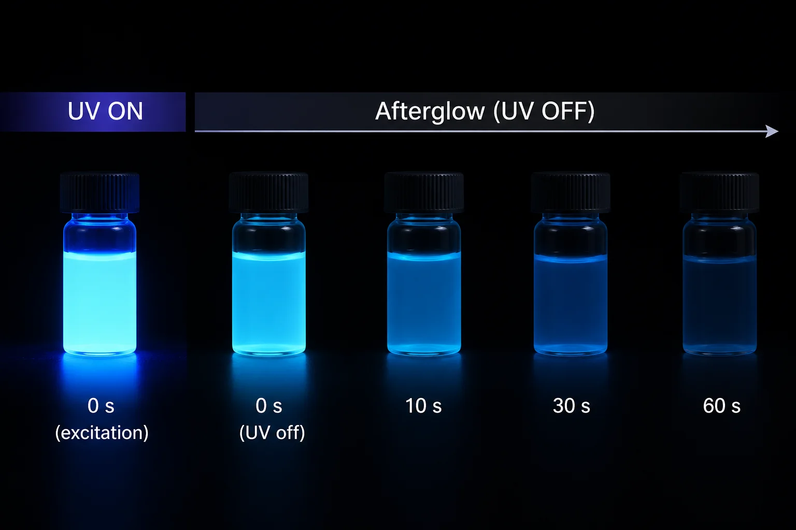

# 如何设计有机余辉探针？

*How to Design Organic Afterglow Probes?*

传统荧光成像通常需要实时光激发，而有机余辉成像能够在外部激发停止后继续采集发光信号，从而显著降低生物组织自发荧光的干扰，为高灵敏度分子成像提供新的思路。[1]

近年来，随着有机发光材料和分子成像技术的发展，研究者逐渐从经验性的材料筛选走向更加理性的分子设计。[2–4]

那么，如何设计一个理想的有机余辉探针？

## 01｜能量输入：如何激活？

**Energy Input**

发光始于能量的输入。

如何选择合适的激发方式，并将外部能量有效转化为可用于后续发光的能量，是余辉探针设计的首要问题。

对于生物医学应用而言，激发效率、组织穿透能力和生物安全性同样值得关注。[3,5]

## 02｜能量储存：如何让光持续？

**Energy Storage**

对于化学发光型有机余辉探针而言，其基本原理是通过化学反应将外部输入的能量储存在化学中间体中，随后通过中间体的分解逐渐释放能量。[2,3]

储能中间体的形成效率、稳定性和分解动力学，共同影响余辉的强度与持续时间。

值得注意的是，更长的余辉并不一定意味着更好的成像表现。如何平衡发光强度与持续时间，是分子设计中的重要问题。

## 03｜发光输出：如何让光更有效？

**Light Emission**

能量的释放并不意味着高效发光。

如何提高化学激发效率、减少非辐射能量损失、优化能量传递过程以及调控发射波长，是提升有机余辉性能的重要途径。[3,4]

特别是在生物医学成像中，发光信号还需要克服组织吸收和散射等因素的影响。

因此，探针设计需要综合考虑余辉亮度、持续时间和发射波长，而非单纯追求某一项性能指标。

## 04｜生物响应：如何让光携带信息？

**Biological Responsiveness**

一个理想的分子探针不仅需要发光，还需要让光具有明确的生物学意义。

通过引入生物识别功能，使余辉信号与特定生物标志物或病理过程建立联系，可以实现从单纯的发光材料向可激活分子探针的转变。[5,6]

这也是有机余辉在疾病检测、分子成像和精准诊疗中具有潜在应用价值的重要原因。

## 05｜从分子设计到生物医学应用

**From Molecular Design to Biomedical Applications**

有机余辉探针的设计并非简单地追求更亮、更久或更长波长的发光，而是需要理解分子结构、化学反应、能量转化与生物功能之间的内在联系。

我的研究主要围绕化学发光型有机余辉探针的分子设计、发光调控及其在肿瘤诊疗中的应用展开。

在这一研究过程中，我始终关注一个基本问题：

**如何通过化学分子设计，让光不仅能够持续存在，还能够准确地传递生命信息？**

---

## References

[1] Miao, Q. et al. Molecular afterglow imaging with bright, biodegradable polymer nanoparticles. *Nature Biotechnology*, **2017**, 35, 1102–1110.  
DOI: 10.1038/nbt.3987

[2] Jiang, Y. et al. A generic approach towards afterglow luminescent nanoparticles for ultrasensitive in vivo imaging. *Nature Communications*, **2019**, 10, 2064.  
DOI: 10.1038/s41467-019-10119-x

[3] Wang, X.; Pu, K. Molecular substrates for the construction of afterglow imaging probes in disease diagnosis and treatment. *Chemical Society Reviews*, **2023**, 52, 4549–4566.  
DOI: 10.1039/D3CS00006K

[4] Zhu, J.; Zhao, L.; An, W.; Miao, Q. Recent advances and design strategies for organic afterglow agents to enhance autofluorescence-free imaging performance. *Chemical Society Reviews*, **2025**, 54, 1429–1452.  
DOI: 10.1039/D4CS01060D

[5] Xu, C.; Zhang, Y.; Liang, G.; Pu, K. Molecular afterglow imaging for biomedical applications. *Nature Materials*, **2025**, 24, 1694–1708.  
DOI: 10.1038/s41563-025-02338-z

[6] Wu, L. et al. H₂S-activatable near-infrared afterglow luminescent probes for sensitive molecular imaging in vivo. *Nature Communications*, **2020**, 11, 446.  
DOI: 10.1038/s41467-020-14307-y
